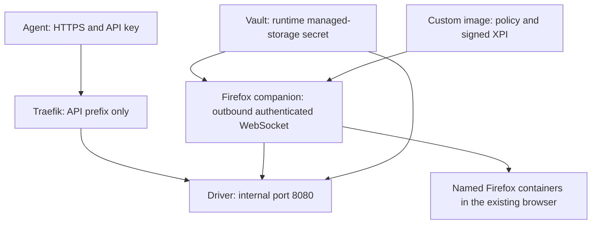

# Kasm Firefox Agent Driver

Operate an existing Kasm Firefox browser through a private driver and a signed
Manifest V2 companion extension. Named Firefox containers keep sessions apart
inside the existing browser and persistent home volume.

**Release status:** Firefox runtime fixes have passed a local browser test.
The new 0.1.1 source requires a matching AMO-signed extension before the
Kasm image builds. The previous 0.1.0 XPI must not be reused. See
[verification](docs/VERIFICATION.md) for the boundary of the local test.

## How it works

An agent sends a JSON command over HTTPS with `X-API-Key`. Traefik routes only
the API prefix to the driver. The Firefox extension opens its own authenticated
outbound WebSocket on the private Docker network. Its persistent background
page routes commands to the requested container and injects packaged DOM
operations into the selected tab.



The driver exposes no host port. `/ws`, placeholder pages and the XPI have no
public driver route. The browser root continues through its existing Authelia
and Kasm header middleware. Gzip remains disabled. The custom image inherits
Kasm's entrypoint, command and startup script; it creates no separate profile
and enables no browser debugging port.

## Repository guide

| Area | Purpose |
| --- | --- |
| [Build plan](docs/BUILD_PLAN.md) | Scope, contract, state transitions and release gates |
| [Deployment guide](docs/DEPLOYMENT.md) | Exact source/branch/compose path, secret names, preflight, deployment and rollback |
| [Operator guide](docs/OPERATIONS.md) | Everyday commands, recovery and ChatGPT interactions |
| [Driver API](driver/README.md) | Endpoints, authentication, errors, delivery semantics and logging |
| [OpenAPI](docs/openapi.json) | Generated from the shared command definition |
| [Extension guide](docs/extension.md) | Permissions, container/document guards and DOM behavior |
| [Verification](docs/VERIFICATION.md) | Local evidence and the eight outstanding live checks |
| [AMO review notes](docs/amo-reviewer-notes.md) | Signing constraints and data-transmission disclosure |
| [Upstream provenance](third_party/foxmcp/NOTICE.md) | Scoped FoxMCP adaptation and retained MIT attribution |

Run `npm run docs` to read the OpenAPI definition through the self-hosted Scalar
reference at `http://127.0.0.1:8089`. This local reference loads its assets from
the installed package, has request execution disabled, and takes no production
credentials. It is not exposed by the deployment.

## API and command protocol

The base path is `/agent-driver/v1`. The API is for server-side callers, requires
`X-API-Key` on every endpoint, rejects browser `Origin` headers, and never accepts
keys in URLs. A separate secret authenticates the extension socket. The two
secrets must be independent, cryptographically random values with at least
32 random bytes, base64url encoded.

| Method | Endpoint | Purpose |
| --- | --- | --- |
| GET | `/agent-driver/v1/status` | Extension readiness and protocol version |
| POST | `/agent-driver/v1/commands` | Dispatch a single command and await its result |
| GET | `/agent-driver/v1/openapi.json` | Authenticated API definition |

Requests use `{id,cmd,container,...}`. The API generates an ID when omitted and
adds an authoritative execution deadline. `timeoutMs` defaults to 15000 and is
bounded to 100–60000. Replies are either:

```json
{"id":"ensure-1","ok":true,"result":{"name":"ChatGPT 1","cookieStoreId":"firefox-container-5","color":"blue","icon":"fingerprint"}}
```

```json
{"id":"read-1","ok":false,"error":{"code":"CONTAINER_MISMATCH","message":"The tab does not belong to the requested named container."}}
```

The IDs in these examples are illustrative. Use the actual returned tab and
container IDs when issuing subsequent commands.

| Command | Required fields beyond `cmd` | Optional fields | Result |
| --- | --- | --- | --- |
| `containers.ensure` | `container` | `color`, `icon` | Create or reuse exact name; update supplied appearance |
| `containers.list` | None | None | Contextual identities and their cookie stores |
| `tabs.create` | `container`, `url` | `active` | Open a tab in that container |
| `tabs.navigate` | `container`, `tabId`, `url` | None | Navigate an allowed tab |
| `tabs.close` | `container`, `tabId` | None | Close that tab |
| `tabs.list` | `container` | None | Allowed-origin tabs in that exact container |
| `tabs.readText` | `container`, `tabId` | `selector`, `maxLength` | Bounded visible page text and truncation flag |
| `tabs.eval` | `container`, `tabId`, `probe` | `selector` for `elements` | Packaged read-only diagnostics |
| `tabs.click` | `container`, `tabId`, `selector` | None | Direct `.click()` on exactly one verified element |
| `tabs.type` | `container`, `tabId`, `selector`, `text` | `clear` | Native setter/editing plus input/change events; verify retained text |

| `tabs.setEffort` | `container`, `tabId`, `effort` | None | Verified composer effort label |
| `tabs.approve` | `container`, `tabId` | `service` | Inspect prompt or explicitly grant full-conversation authority |
| `tabs.key` | `container`, `tabId`, `key` | None | Synthetic DOM keydown/keyup |

| `tabs.inspectAt` | `container`, `tabId`, `x`, `y` | None | Hit element, ancestors and one-use inspection ID |
| `tabs.clickAt` | `container`, `tabId`, `x`, `y`, `inspectionId` | None | Inspected coordinate pointer/mouse dispatch |
| `tabs.mapInteractive` | `container`, `tabId` | None | Visible interactive control geometry |

Every tab command requires an exact named container. Duplicate names are errors;
the driver never silently chooses one. A tab's current cookie store and URL are
checked immediately before the action. DOM commands additionally bind to a
specific document token and URL, preventing a navigation from retargeting an
in-flight action. Default-store tabs and unrelated origins are excluded.

Host permissions are exactly `https://chatgpt.com/*` and `http://driver/*`.
Runtime validation restricts the latter to `http://driver:8080`. No broad
`<all_urls>` or browser-wide tab-reading permission is requested.

### The `tabs.eval` signing limitation

This command **does not execute arbitrary JavaScript**. Its probes are `page`
(title/URL/readiness), `elements` (metadata for one selector), and `storage`
(only the benign `localStorage.kasm_probe` marker on the internal fixture
origin). Supplied code, expressions and scripts return
`REMOTE_CODE_FORBIDDEN`. This keeps executable behavior inside the signed
package, consistent with [Mozilla's add-on policies](https://extensionworkshop.com/documentation/publish/add-on-policies/).
AMO review and acceptance remain external gates.

### Example server-side client

The included Python client reads `DRIVER_API_URL` and `DRIVER_API_KEY_FILE`
from its secure execution environment. The key never appears in command-line
arguments and redirects are refused rather than forwarding it elsewhere.

```bash
python3 scripts/client.py status
python3 scripts/client.py command <<'JSON'
{"id":"ensure-1","cmd":"containers.ensure","container":"ChatGPT 1","color":"blue","icon":"fingerprint"}
JSON
python3 scripts/client.py command <<'JSON'
{"id":"open-1","cmd":"tabs.create","container":"ChatGPT 1","url":"https://chatgpt.com/"}
JSON
```

A timeout or connection loss after dispatch means the action **may already
have run**. Inspect the page before issuing another mutation. Reconnect does
not replay requests. Accepted IDs are retained for 15 minutes in driver memory;
restart resets that cache, so callers must not rely on it for persistent
exactly-once delivery.

## Build, sign and deploy

Use Node 24.22.3, Python 3, and PyYAML 6.0.3 for deployment source checks.

```bash
npm ci
npm test
npm run lint:extension
npm run check:compose
node scripts/generate-api-docs.js --check
npm run build:extension
python3 scripts/verify-xpi.py artifacts/kasm-agent-unsigned.xpi
```

Only after the unsigned XPI is ready, provision `AMO_JWT_ISSUER` and
`AMO_JWT_SECRET` through an available secure credential/vault channel. Run
`npm run sign:extension` or the isolated `Sign unlisted extension` workflow.
The script passes credentials through process environment variables, suppresses
raw signing-service output and never puts credentials inside the XPI.

AMO may require review rather than return a signature immediately. Never
disable signature enforcement or claim acceptance from the ZIP's filenames.
The artifact verifier checks source equality, identity, metadata hash and
signature structure. Stock Firefox Release accepting the policy-installed
extension is the final cryptographic acceptance check.

Commit only the verified final signed XPI and its hash metadata on the release
branch before Coolify builds a fresh checkout. Then follow the
[deployment guide](docs/DEPLOYMENT.md), including the live configuration read,
existing volume/network identification, secure secret source, Authelia check,
rollback snapshot and all eight acceptance gates. No merge is required merely
to deploy the reviewed branch.

## Secret names

| Name | Use |
| --- | --- |
| `VNC_PW` | Existing Kasm secret; preserve its current secure reference |
| `DRIVER_API_KEY` | New agent API key; mounted only in driver |
| `DRIVER_MANAGED_STORAGE` | Native managed-storage JSON containing the separate WS token; shared secret mount |
| `AMO_JWT_ISSUER` | Signing-only API issuer |
| `AMO_JWT_SECRET` | Signing-only API secret |

Secret values are never committed. The signed extension contains no token.
Firefox reads the managed secret from
`/usr/lib/mozilla/managed-storage/kasm-agent@chabad.gr.json` and its force-install
policy from `/etc/firefox/policies/policies.json`. This uses native Firefox and
Docker Compose mechanisms, with no replacement startup script.

The owner signs in once in each container after deployment. The automation
never enters credentials or handles 2FA. Cookies persist in the existing Kasm
home volume; placeholder pages are used to verify separation without real
logins.

### Conversation controls (0.1.2)
 
All use the existing named container, tab ID, document token, deadline and replay
guard. No automatic approval or retry occurs. `tabs.setEffort` and
`tabs.approve` are restricted to https://chatgpt.com, not the fixture.
 
- `tabs.setEffort`, `effort: "Low" | "Medium" | "High"`: locate the composer,
  open the effort picker, drag the identified track and verify the composer
  label. No Pro selection. Unknown or ambiguous markup, or a label that does
  not change, fails explicitly.
- `tabs.approve`: omit `service` for read-only inspection, returning
  `found`, exact question and description text, and `approved:false`.
  For a grant, explicitly supply the exact service name (e.g. `"GitHub"`).
  The packaged action matches the question, opens the Approval options menu,
  checks the second item's exact full-conversation label, and verifies that
  the form disappears. It never activates Allow once, guesses a menu item, or
  grants an unrequested service. A timeout after activation is an unknown
  outcome; inspect before retrying. English UI wording is required.
- `tabs.key`, `key: "Escape"`, `"Enter"`, `"ArrowDown"`, or
  `"Ctrl+Shift+M"`: dispatch bounded synthetic keydown/keyup events on the
  target document's focused element. These are not trusted native input,
  cannot invoke browser-level shortcuts or guarantee default browser editing
  or form submission. The result reports dispatch and default prevention,
  not application acceptance. Password/file/credential inputs are excluded.
 
The effort geometry and approval markup are based on reported UI observations
and synthetic fixtures; no claim of real ChatGPT compatibility is made until
a separately authorized, isolated account acceptance check. The existing
signed 0.1.1 artifact remains historical and must not be used to build 0.1.2.

### Viewport inspection and coordinate controls

These three commands are ChatGPT-only. Coordinates are CSS viewport pixels,
not page-scroll offsets or screenshot/device pixels. The map returns up to 150
visible enabled semantic controls (bounded labels/text and bounding rectangles);
it reports truncation and is not a screenshot or guarantee of hitability.
Role-less controls are reachable with point inspection.

- `tabs.mapInteractive`: no extra fields; read-only visible control inventory.
- `tabs.inspectAt`: `x`, `y`; hit-tests with elementFromPoint and returns the
  element plus ancestors (tag, explicit role, ariaLabel, text, rect), viewport
  and an inspectionId. A new inspection supersedes the previous one.
- `tabs.clickAt`: identical `x`, `y`, and the returned `inspectionId`.
  The one-use inspection expires after 30 seconds and is bound to the document,
  URL, exact target, ancestry and geometry. Changed or covered targets fail.
  The action dispatches pointer/mouse events at the inspected point, not a
  center click or native browser input. Inspect the application's response
  before retrying; dispatch does not establish acceptance.

No new host permission, arbitrary code, frame traversal, credential input,
automatic approval, replay or native privileged keyboard/pointer API is added.
Effort drag and approval use the same hit-test primitives; the approval
options trigger is hit near its right edge and the verified conversation
menu item is hit-tested before activation. These are synthetic events
(`isTrusted=false`); isolated real application verification remains required.
